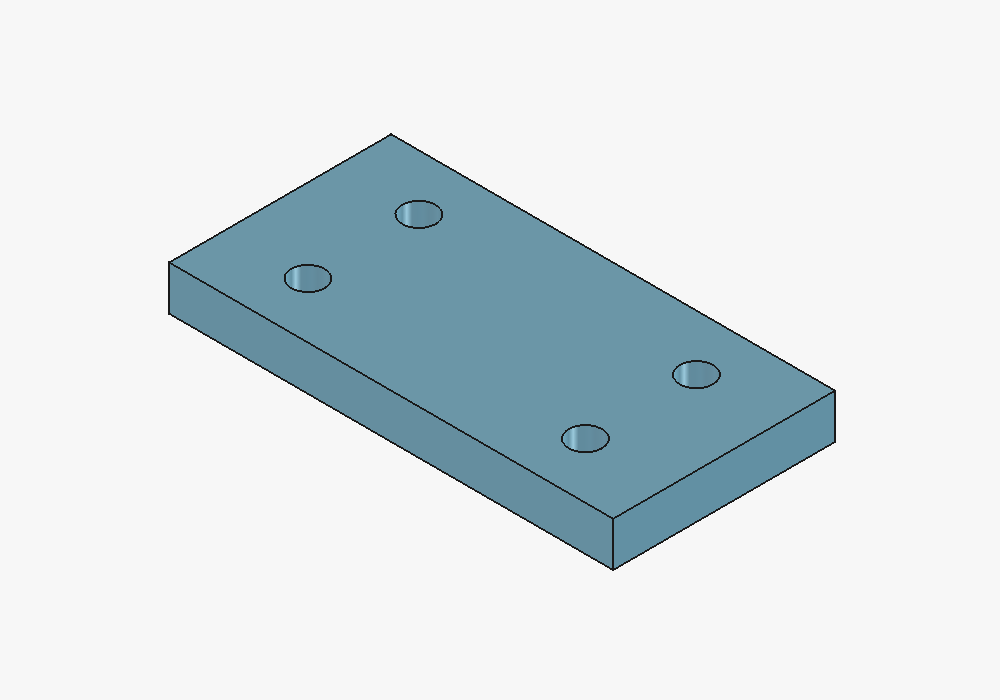

# Phoenix FreeCAD Tools


一个以 **Node.js / TypeScript** 为主的 FreeCAD 工具项目，当前实现独立 MCP 最小原型。通过轻量 Python 工作台连接 FreeCAD，支持连接检测、文档列表、适合窗口（fit）和轴测图。项目应用代码采用 **Apache-2.0**。

```text
MCP 聊天客户端 ──stdio──> Node.js / TypeScript 服务
                              │ JSON HTTP（仅本机 9876）
                              ▼
                     FreeCAD PhoenixFreeCADMCP 工作台
                              │ Qt GUI 主线程
                              ▼
                       文档列表 / fit / 轴测图
```

Node MCP 是聊天客户端启动的进程；FreeCAD 工作台启动的是应用内桥接服务。两者启动后才能控制视图。

## 当前原型

本地原型已验证：独立插件安装、真实 MCP 工具发现、连接板样例轴测图与 fit；Node 16项、Python 19项测试通过。详细证据和已知边界见 [验证记录](docs/VERIFICATION.md)。



## 安装

需要 Node.js 22+、npm，以及带 GUI 的 FreeCAD。本机验证目标为 FreeCAD 1.1；其他平台可指定 Mod 目录，尚需真实环境验证。

```bash
npm ci
npm run build
npm run addon:install
```

macOS 会优先使用已存在的 `~/Library/Application Support/FreeCAD/v1-1/Mod`。其他位置请明确指定：

```bash
npm run addon:install -- --mod-dir "/your/FreeCAD/Mod" --dry-run
npm run addon:install -- --mod-dir "/your/FreeCAD/Mod"
```

安装后重新打开 FreeCAD，在工作台下拉框选择 **Phoenix FreeCAD**，点击 **启动 MCP 服务**。工作台界面只提供服务启动/停止，插件不会自动启动。fit 和轴测通过 MCP 工具调用 FreeCAD 原生 API，作为聊天可用能力，不另设工具栏按钮。

如当前 FreeCAD 有未保存修改，可安装后在其 Python 控制台执行下列代码，先启动桥接服务，无需重启：

```python
import os, sys, FreeCAD as App
p = os.path.join(App.getUserAppDataDir(), "Mod", "PhoenixFreeCADMCP")
sys.path.insert(0, p) if p not in sys.path else None
import phoenix_freecad_bridge
phoenix_freecad_bridge.start_server()
```

工作台菜单将在正常重新启动后由 FreeCAD 加载。已加载模块升级需要停止服务并重新加载模块或正常重启；覆盖磁盘文件不等于运行代码已更新。

## 最小验证

启动 FreeCAD 插件后：

```bash
npm run check
```

预期为 `ok: true`，`protocol_version: 1`，`running: true`。本机服务默认地址为 `http://127.0.0.1:9876/`。可用环境变量 `PHOENIX_FREECAD_URL` 指定另一本机地址，`PHOENIX_TIMEOUT_MS` 指定等待时间。程序不会自动读取 `.env`。

验证采用公开的 [phoenix-freecad-study](https://gitee.com/PhoenixWing321/phoenix-freecad-study) 仓库：

1. 在 FreeCAD 中打开 `04-自动出图/样本/8101.001-H-PX-连接板.FCStd`。
2. 在 Python 控制台读取 `App.ActiveDocument.Name`，取得内部文档名。
3. 执行真正的 MCP 工具调用验证：

```bash
npm run verify:mcp -- --document "这里填内部文档名"
```

这会通过官方 MCP 客户端启动本项目，发现工具、检查连接、验证目标文档存在，然后对指定文档调用轴测图与 fit。脚本只在内存中确认其他文档列表，输出不记录其他工程名称。无需复制公开模型到本项目。该样例源仓库采用 MIT，重新分发模型时保留其许可。

也可用 `npm run demo` 对**当前活动文档**直接演示轴测图并适合窗口；它是桥接诊断，不替代上述 MCP 协议验证。

## Codex 优先接入

具体注册命令、示例问法和验证边界见 [Codex 接入](docs/CODEX.md)。其他兼容客户端可使用相同 stdio 入口。

## 连接聊天客户端

使用支持 stdio MCP 的客户端，配置示例（替换为本机绝对路径）：

```json
{
  "mcpServers": {
    "phoenix-freecad": {
      "command": "/absolute/path/to/node",
      "args": ["/absolute/path/to/phoenix-freecad-tools/dist/cli.js"]
    }
  }
}
```

在客户端重新连接或加载该 MCP 后，可说：“检查 Phoenix FreeCAD 连接”“列出打开的文档”“把指定文档切换为轴测图并适合窗口”。普通聊天文字不会自动安装或启用本机 MCP。

| 工具 | 作用 |
| --- | --- |
| `get_capabilities` | 查看本版支持的能力，无需连接 FreeCAD |
| `get_connection_status` | 检查插件版本、协议与调度状态 |
| `list_documents` | 读取当前打开的文档内部 Name |
| `fit_view` | 调整目标文档相机，使模型适合窗口 |
| `set_axonometric_view` | 切换轴测图，可设置 `fit: true` |

视图工具改变相机；不会创建、修改、保存或关闭模型。文档参数使用内部 `Name`，不是显示 `Label`。省略时使用当前活动文档。超时不会自动重试，已经开始的远端操作可能仍在执行。

## 卸载与开发

```bash
npm run addon:uninstall -- --mod-dir "/your/FreeCAD/Mod"
```

先停止 FreeCAD 中的服务。卸载只处理本项目带标记且内容未被用户修改的 `PhoenixFreeCADMCP`，并移到 Mod 父目录下的 `.phoenix-freecad-mcp/` 保留恢复副本；原 MCP 不受影响。用户修改或额外文件会阻止覆盖/卸载。

```bash
npm run build
npm test
npm run test:python
npm pack --dry-run
```

测试包含模拟 HTTP 与真实 stdio MCP 握手、错误返回、安装保护及 Python 协议/线程调度 stub；真实 FreeCAD 联调记录见 [验证记录](docs/VERIFICATION.md)，实施阶段见 [计划](docs/PLAN.md)，命名、技术选择与 Tool 复用讨论见 [架构决定](docs/DECISIONS.md)，内部通信见 [桥接协议](docs/PROTOCOL.md)。

## 依赖与资源来源

- [官方 TypeScript SDK](https://github.com/modelcontextprotocol/typescript-sdk)：MCP 协议与 stdio。
- Phoenix Tool/Wing：后续 TS 能力复用，首版没有相关业务依赖。

应用源码为独立实现。依赖和参考来源见 [NOTICE](NOTICE)。本机桥接只开放固定方法、拒绝浏览器 Origin 请求，仅用于可信本机环境；首版不提供远程监听和任意代码执行。

接下来优先扩展 [零件与图纸设计能力](docs/CAPABILITY-PLAN.md)：设计上下文与测量 → 参数化零件 → TechDraw 出图与导出 → 高级设计 → 现有 Tool/Wing 集成。后续工具尚未实现，当前能力以工具表为准。

[FreeCAD 内嵌聊天面板](docs/ROADMAP.md) 保留为独立调查目标，研究复用本机 ChatGPT/Codex 客户端；当前原型尚未实现。项目目录为 `phoenix-freecad-tools`，MCP 包仍为 `phoenix-freecad-mcp`，详见 [命名](docs/NAMING.md)。

本地最新归档标签：`v0.1.0-naming.1`，初始 `v0.1.0` 保留原样。源代码ZIP和npm安装包保存在已忽略的 `archives/`，没有推送远端。归档隐私范围见 [隐私审查](docs/PRIVACY-REVIEW.md)，命名及迁移规则见 [命名](docs/NAMING.md)。

组织 logo 复用 Phoenix Wing 权威品牌资源，来源见 [品牌资源](docs/BRANDING.md)。下一步聊天界面调查见 [TODO](docs/TODO.md)。
